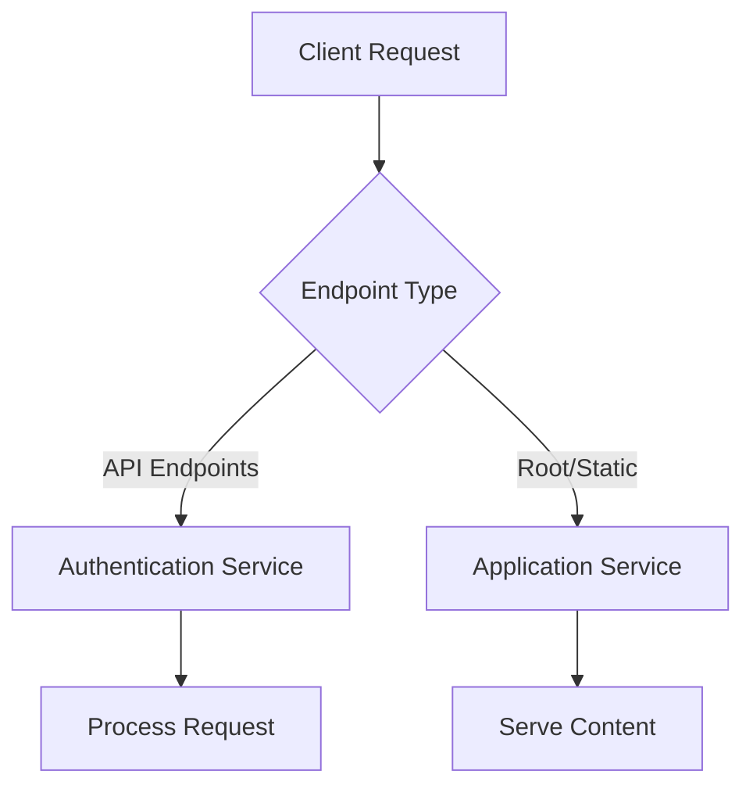

# context

## System Overview
The Fitness Tracker is a comprehensive web-based fitness tracking application that enables users to manage their fitness journey through workout logging, metrics tracking, and training plan management. The system serves both fitness enthusiasts (clients) and fitness professionals (trainers) with role-based functionality.

### Core Purpose

The application provides a centralized platform for:
- **Workout Management**: Log and track workout sessions with detailed metrics
- **Training Plans**: Create, manage, and assign personalized fitness plans
- **Progress Monitoring**: Track fitness metrics and progress over time
- **User Management**: Support for both client and trainer user roles
- **Authentication**: Secure user registration, login, and session management

### System Architecture

The Fitness Tracker follows a modern web application architecture with:

- **Frontend**: Class-based JavaScript architecture with `FitnessApp` and `Dashboard` components
- **Backend**: Service-oriented API design with authentication-first routing
- **Authentication Layer**: Comprehensive auth service handling all protected endpoints
- **Data Management**: RESTful API endpoints for CRUD operations on fitness data

### Key Capabilities

**For Clients:**
- Register, manage personal fitness profiles
- Log workout sessions

**For Trainers:**
- Create and manage training plans for clients
- Monitor client progress and workout compliance
- Access client metrics and performance data
- Manage multiple client relationships

**System Features:**
- Role-based access control (client/trainer)
- Secure authentication and session management
- Responsive web interface with modal-based interactions
- RESTful API design for scalable data operations

## Domain Model
### Core Entities

#### User Management
- **Users**: Central entity representing application users with email-based identification
- **Authentication**: Handles user login, logout, and registration processes
- **Roles**: User role-based access control (referenced in login forms)

#### Fitness Data
- **Workouts**: User exercise sessions that can be logged and retrieved
- **Metrics**: User fitness measurements and progress tracking data
- **Plans**: Training plans that can be created, updated, and associated with trainers

#### Application Components
- **FitnessApp**: Main application orchestrator handling modals, forms, and user interactions
- **Dashboard**: User interface component managing user elements and session control

### Entity Relationships

### Responsibilities

#### Authentication Service
- User registration and login validation
- Session management (login/logout)
- Access control for protected endpoints
- Workout logging authorization
- Metrics and plans management

#### Application Service
- Root application serving
- User-Agent handling
- General request processing

#### Frontend Classes
- **FitnessApp**: Application initialization, modal management, form handling
- **Dashboard**: User interface state management, logout functionality

### Data Access Patterns

The application follows a service-oriented approach where:
- All fitness data operations (workouts, metrics, plans) require authentication
- User identification is email-based across all entities
- Plans are associated with trainers and can be managed (CRUD operations)
- Form initialization is handled through dedicated handlers for login components

## API Inventory
### Authentication Endpoints

| Method | Path | Purpose |
|--------|------|----------|
| POST | `/login` | Authenticate user login |
| POST | `/logout` | Log out current user |
| POST | `/register` | Register a new user account |

### User Management

| Method | Path | Purpose |
|--------|------|----------|
| GET | `user` | Retrieve current user information |
| GET | `User-Agent` | Retrieve user agent information |

### Workout & Metrics Management

| Method | Path | Purpose |
|--------|------|----------|
| POST | `/log-workout` | Log a new workout entry |
| GET | `/workouts/:email` | Retrieve workouts for a specific user by email |
| POST | `/metrics` | Create new user metrics |
| GET | `/metrics/:email` | Retrieve metrics for a specific user by email |

### Fitness Plan Management

| Method | Path | Purpose |
|--------|------|----------|
| POST | `/plans` | Create a new fitness plan |
| GET | `/plans/:trainer` | Retrieve plans for a specific trainer |
| PUT | `/plans/:id` | Update an existing plan by ID |
| DELETE | `/plans/:id` | Delete a specific plan by ID |

### Form Components

| Method | Path | Purpose |
|--------|------|----------|
| GET | `email-login` | Retrieve email login form component |
| GET | `password-login` | Retrieve password login form component |
| GET | `role-login` | Retrieve role login form component |

### Application Endpoints

| Method | Path | Purpose |
|--------|------|----------|
| GET | `/` | Main application root endpoint |
| POST | `/test` | Test endpoint for development purposes |

All authenticated endpoints are processed through the `auth` handler, while general application requests are handled by the `app` handler. The API supports role-based access with separate endpoints for trainers and clients.

## Data Flows
The Fitness Tracker application follows several key data flow patterns for request processing and user interactions.

### Authentication Flow
Most API endpoints route through the authentication service as the primary processing layer:



### Core API Request Flows

#### User Management Flow
- `POST /login` → Authentication Service → User Session Creation
- `POST /register` → Authentication Service → New User Account
- `POST /logout` → Authentication Service → Session Termination
- `GET user` → Load Current User Handler → User Data Retrieval

#### Data Operations Flow
- `GET /metrics/:email` → Authentication Service → User Metrics Retrieval
- `POST /metrics` → Authentication Service → Metrics Creation
- `GET /workouts/:email` → Authentication Service → Workout History
- `POST /log-workout` → Authentication Service → Workout Logging

#### Plan Management Flow
- `GET /plans/:trainer` → Authentication Service → Trainer Plans Retrieval
- `POST /plans` → Authentication Service → Plan Creation
- `PUT /plans/:id` → Authentication Service → Plan Updates
- `DELETE /plans/:id` → Authentication Service → Plan Deletion

### Frontend Form Initialization Flow
Login form components follow a specialized initialization pattern:

- `GET email-login` → Initialize Login Form Handler → Email Form Setup
- `GET password-login` → Initialize Login Form Handler → Password Form Setup
- `GET role-login` → Initialize Login Form Handler → Role Form Setup

### Application Entry Points
- `GET /` → Application Service → Main Application Interface
- `GET User-Agent` → Application Service → Browser Detection

The architecture demonstrates a clear separation between authenticated operations (routed through the auth service) and general application functionality (handled by the app service).

## External Integrations
services to provide comprehensive functionality:

### Authentication Service
The application routes multiple endpoints through an authentication service (`auth`) for secure access control:
- User authentication: `/login`, `/logout`, `/register`
- Data access: `/metrics/:email`, `/workouts/:email`, `/plans/:trainer`
- Data modification: `/log-workout`, `/metrics`, `/plans`, `/plans/:id`
- Testing: `/test`

### Application Handler
Core application functionality is managed through the main application handler (`app`):
- Root endpoint: `/`
- User-Agent processing: `User-Agent`

### Form Initialization Service
Login form components are managed through a dedicated initialization service (`initializeLoginForm`):
- Email login: `email-login`
- Password login: `password-login`
- Role-based login: `role-login`

### User Management Service
User data loading is handled through a specialized service (`loadCurrentUser`):
- Current user retrieval: `user`

### Integration Architecture
The application follows a service-oriented architecture where:
- Authentication is centralized through the `auth` service
- Form handling is abstracted through initialization services
- User data management is separated into dedicated handlers
- All external integrations route through well-defined service boundaries

## User Journeys
### End User Journey

#### New User Registration and Onboarding
1. **Registration**: User accesses the application and creates an account via `POST /register`
2. **Login**: User authenticates using email and password through `POST /login`
3. **Dashboard Access**: Upon successful authentication, user is redirected to the main dashboard
4. **Profile Setup**: User can create initial metrics via `POST /metrics`

#### Daily Workout Management
1. **View Workouts**: User retrieves their workout history via `GET /workouts/:email`
2. **Log New Workout**: User records workout sessions through `POST /log-workout`
3. **Track Progress**: User views their fitness metrics via `GET /metrics/:email`
4. **Logout**: User securely logs out via `POST /logout`

### Trainer Journey

#### Plan Management Workflow
1. **Authentication**: Trainer logs in using role-based authentication
2. **View Plans**: Trainer accesses their created plans via `GET /plans/:trainer`
3. **Create Plans**: Trainer develops new fitness plans through `POST /plans`
4. **Update Plans**: Trainer modifies existing plans via `PUT /plans/:id`
5. **Remove Plans**: Trainer deletes outdated plans through `DELETE /plans/:id`

### Developer Journey

#### Frontend Development Flow
1. **Component Initialization**: Developer uses `FitnessApp` class for main application setup
2. **Form Management**: Developer leverages login form handlers (`initializeLoginForm`) for authentication UI
3. **User State**: Developer implements user management through `Dashboard` class methods
4. **Testing**: Developer validates functionality using `POST /test` endpoint

#### Authentication Integration
1. **Handler Setup**: Developer configures `auth` handler for protected endpoints
2. **User Loading**: Developer implements `loadCurrentUser` for session management
3. **Route Protection**: Developer ensures all user-specific endpoints require authentication
4. **Session Management**: Developer handles login/logout state through dedicated endpoints

## Deployment Notes
### Inferred Runtime Layout

Based on the application architecture, the Fitness Tracker appears to follow a standard web application deployment pattern:

**Frontend Layer**
- JavaScript classes (FitnessApp, Dashboard) served as static assets
- Client-side form initialization and user interface management
- Browser-based execution environment

**Backend Layer**
- Authentication service handling API endpoint routing
- Application service providing core functionality
- Service-oriented architecture with authentication-first design

**Data Flow Topology**

```
Client Browser → Authentication Service → Application Services
     ↓                    ↓                      ↓
Frontend Classes    API Routing Layer    Core Business Logic
```

### Deployment Considerations

**Known Patterns**
- Class-based frontend requires module loading capability
- Authentication service acts as API gateway
- Service routing suggests microservices or modular monolith architecture

**Configuration Gaps**
- Service deployment configuration not documented
- Service relationships
