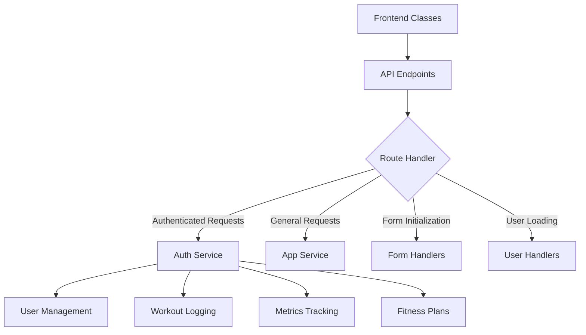
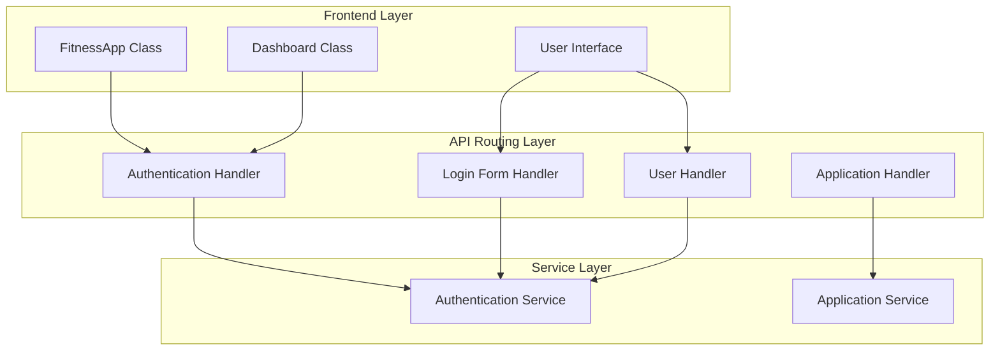
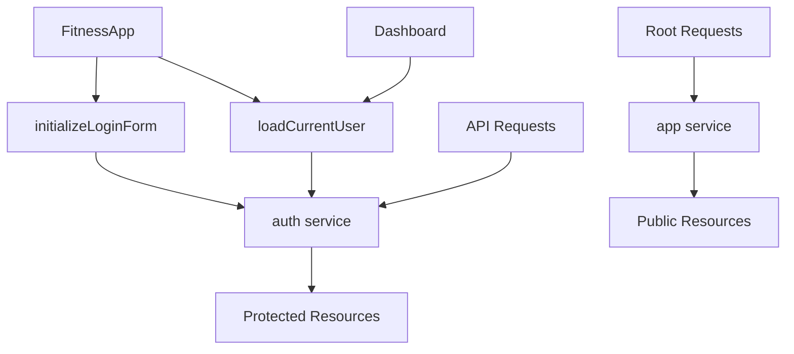
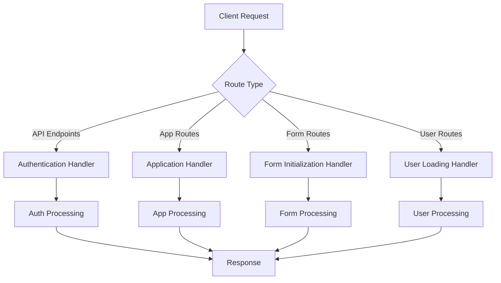
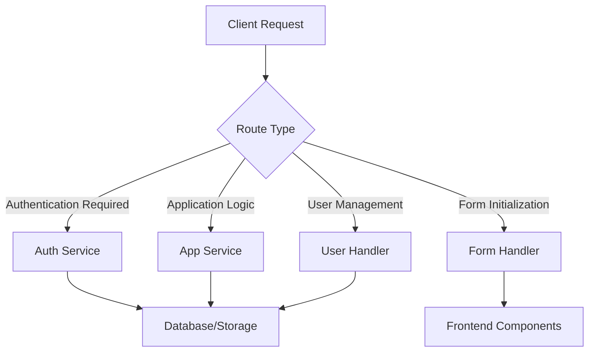
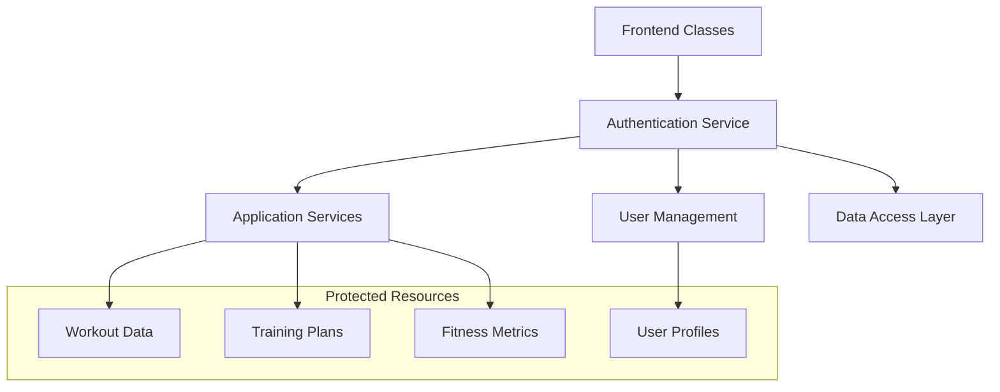
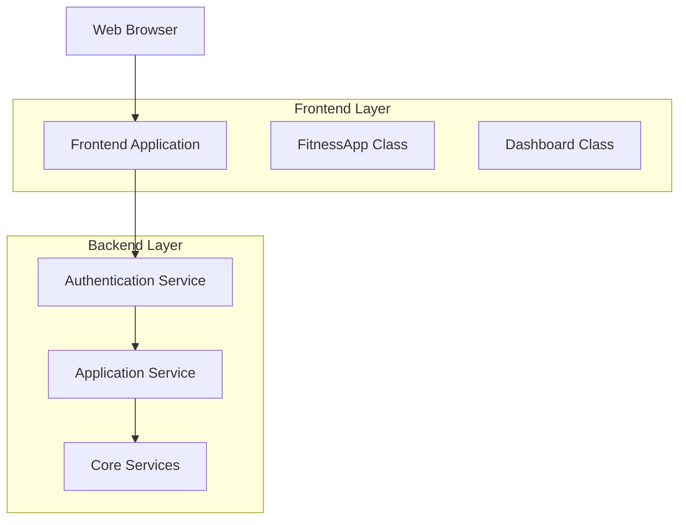
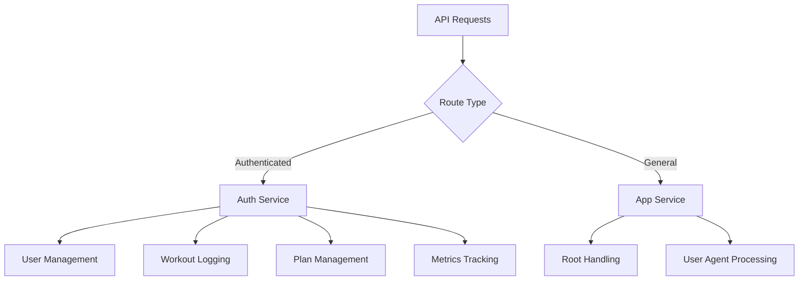
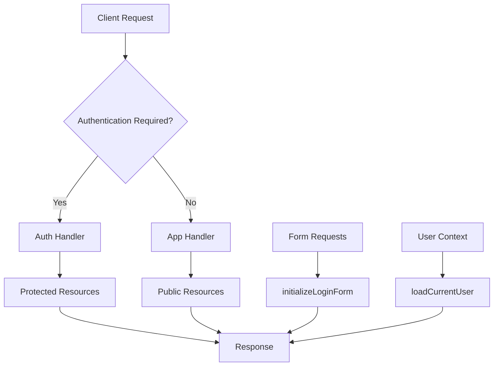

# architecture

## Repository Overview
The Fitness Tracker is a comprehensive web application designed to manage fitness activities, workout plans, and user metrics. The application serves both fitness trainers and clients through a role-based system that enables workout planning, progress tracking, and user management.

### Purpose

- **User Management**: Registration and authentication for trainers and clients
- **Workout Tracking**: Logging and monitoring of fitness activities
- **Training Plans**: Creation and management of personalized workout plans
- **Metrics Tracking**: Recording and analysis of fitness progress data
- **Role-Based Access**: Differentiated functionality for trainers and clients

### Architecture Approach

backend concerns:

- **Frontend**: Class-based JavaScript architecture with modular components
- **Backend**: Service-oriented API design with authentication-first routing
- **Data Flow**: Centralized API routing through authentication layer ensuring secure access

The application emphasizes user experience through interactive dashboards and form-based interfaces while maintaining robust backend services for data management and business logic.

## Architecture Overview
The Fitness Tracker application follows a **service-oriented architecture** with a clear separation between frontend and backend concerns, implementing an **authentication-first API design** pattern.

### System Components

- **FitnessApp Class**: Main application class responsible for initializing modals, forms, login functionality, and user management
- **Dashboard Class**: User interface class handling dashboard initialization, user elements management, and logout functionality
- **Authentication Service**: Core backend service processing all authenticated API requests including user management, workout logging, metrics tracking, and fitness plan operations
- **Application Service**: General-purpose service handling root requests and basic application functionality

### Design Philosophy

The architecture implements several key design patterns:

#### Class-Based Frontend Architecture
The frontend utilizes a **class-based approach** with dedicated classes for different application concerns:
- `FitnessApp` serves as the main application controller
- `Dashboard` manages user interface interactions
- Global functions like `logout` provide shared functionality across components

#### Authentication-First API Design
All core business logic endpoints route through the authentication service, ensuring:
- Centralized security control
- Consistent user session management
- Protected access to sensitive operations (workout logging, metrics, fitness plans)

#### Service-Oriented Backend Routing
The backend implements a **service-oriented routing pattern** where:
- Authentication service handles 12 distinct API endpoints
- Application service manages general requests
- Specialized handlers process specific functionality (login forms, user loading)

### Data Flow Architecture



The system processes requests through three primary data flows:

1. **API Request Flow**: Frontend requests route through authentication service for business operations
2. **Form Initialization Flow**: Login form components initialize through dedicated method calls
3. **User Management Flow**: User-related operations process through specialized class methods and handlers

### Technology Stack

The application is built using **TypeScript** as the primary programming language, providing type safety and enhanced development experience across both frontend and backend components.

## High-Level Design
The Fitness Tracker application follows a layered architecture with clear separation between frontend presentation, API routing, and service layers.

### System Layers



### Subsystem Boundaries

#### Frontend Subsystem
- **FitnessApp Class**: Main application orchestrator handling modals, forms, and user management
- **Dashboard Class**: User interface management with initialization and logout functionality
- **Boundary**: Client-side JavaScript execution environment

#### API Gateway Subsystem
- **Authentication Handler**: Routes all authenticated operations (login, logout, plans, metrics, workouts)
- **Application Handler**: Handles root requests and User-Agent processing
- **Form Handlers**: Specialized handlers for login form initialization and user data loading
- **Boundary**: HTTP request/response processing layer

#### Service Subsystem
- **Authentication Service**: Core authentication and authorized operations
- **Application Service**: General application functionality
- **Boundary**: Business logic and data processing layer

### Layering Strategy

1. **Presentation Layer**: Frontend classes manage user interactions and UI state
2. **API Layer**: Request handlers provide routing and protocol translation
3. **Service Layer**: Core business logic and data operations

The architecture enforces authentication-first design where most API endpoints route through the authentication handler, ensuring security boundaries are maintained across all user operations.

## Component Design
### Core Components

#### Frontend Components

**FitnessApp Class**
- **Responsibility**: Main application orchestration and initialization
- **Key Functions**: Modal management, form initialization, login functionality, and user management
- **Location**: `public/js/app.js`
- **Dependencies**: Interacts with authentication endpoints and user interface elements

**Dashboard Class**
- **Responsibility**: User dashboard management and interface control
- **Key Functions**: Dashboard initialization, user element management, and logout functionality
- **Location**: `public/js/app.js`
- **Dependencies**: Relies on authentication state and user session management

#### Backend Services

**Authentication Service (`auth`)**
- **Responsibility**: Handles all authenticated API operations
- **Endpoints Managed**:
  - User authentication: `/login`, `/logout`, `/register`
  - Workout management: `/log-workout`, `/workouts/:email`
  - Plan management: `/plans`, `/plans/:id`, `/plans/:trainer`
  - Metrics handling: `/metrics`, `/metrics/:email`
  - Testing: `/test`
- **Security Role**: Acts as the primary security gateway for protected resources

**Application Service (`app`)**
- **Responsibility**: Handles general application requests and core functionality
- **Endpoints Managed**:
  - Root application: `/`
  - User agent detection: `User-Agent`
- **Role**: Serves as the main entry point for non-authenticated operations

#### Specialized Handlers

**Login Form Handler (`initializeLoginForm`)**
- **Responsibility**: Manages login form component initialization
- **Components**: Email field (`email-login`), password field (`password-login`), role selection (`role-login`)
- **Integration**: Works with FitnessApp class for form setup

**User Management Handler (`loadCurrentUser`)**
- **Responsibility**: Handles current user information loading and session management
- **Endpoint**: `GET user`
- **Integration**: Supports Dashboard and FitnessApp user state management

### Component Interactions



### Dependencies and Data Flow

1. **Frontend to Backend**: Frontend classes make API calls that are routed through the authentication service for protected operations
2. **Authentication Layer**: The `auth` service acts as a central hub, processing most API endpoints and ensuring proper security
3. **Form Management**: Login forms are initialized through dedicated handlers that integrate with the main application class
4. **User Session**: User data flows from backend handlers through the authentication layer to frontend dashboard components

### Component Responsibilities Matrix

| Component | Authentication | User Management | Workout Tracking | Plan Management | UI Control |
|-----------|---------------|-----------------|------------------|-----------------|------------|
| FitnessApp | ✓ | ✓ | - | - | ✓ |
| Dashboard | - | ✓ | - | - | ✓ |
| auth service | ✓ | ✓ | ✓ | ✓ | - |
| app service | - | - | - | - | ✓ |
| initializeLoginForm | ✓ | - | - | - | ✓ |
| loadCurrentUser | - | ✓ | - | - | - |

## Runtime Design
### Request Lifecycle

The Fitness Tracker application follows a structured request lifecycle with clear routing patterns and execution flows:

#### API Request Flow



#### Route Categories

**Authentication-Routed Endpoints:**
- `POST /login` - User authentication
- `POST /register` - User registration
- `POST /logout` - User logout
- `GET /metrics/:email` - User metrics retrieval
- `GET /workouts/:email` - User workout data
- `GET /plans/:trainer` - Trainer plan access
- `POST /metrics` - Metrics creation
- `POST /plans` - Plan creation
- `PUT /plans/:id` - Plan updates
- `DELETE /plans/:id` - Plan deletion
- `POST /log-workout` - Workout logging
- `POST /test` - Testing endpoint

**Application-Routed Endpoints:**
- `GET /` - Root application access
- `GET User-Agent` - User agent handling

**Form Initialization Routes:**
- `GET email-login` - Email login form
- `GET password-login` - Password login form
- `GET role-login` - Role login form

**User Management Routes:**
- `GET user` - Current user data loading

### Execution Flows

#### Authentication Flow
1. Client sends request to authenticated endpoint
2. Request routes through authentication handler
3. Authentication validation occurs
4. Authorized requests proceed to business logic
5. Response returned to client

#### Form Initialization Flow
1. Client requests form component
2. Request routes to `initializeLoginForm` handler
3. Form component initialized with appropriate configuration
4. Form markup/data returned to client

#### User Data Flow
1. Client requests user information
2. Request routes to `loadCurrentUser` handler
3. Current user context loaded
4. User data returned to client

### Concurrency Considerations

#### Frontend Concurrency
- **Class-based Architecture**: `FitnessApp` and `Dashboard` classes manage concurrent UI operations
- **Event-driven Processing**: Form interactions and user actions handled asynchronously
- **State Management**: User session state maintained across concurrent requests

#### Backend Concurrency
- **Handler Isolation**: Separate handlers (`auth`, `app`, `initializeLoginForm`, `loadCurrentUser`) enable concurrent request processing
- **Route Segregation**: Different route categories can be processed simultaneously
- **Stateless Design**: Authentication and application handlers designed for concurrent access

#### Request Patterns
- **CRUD Operations**: Full CRUD support for plans (`POST`, `GET`, `PUT`, `DELETE`)
- **User-scoped Requests**: Email-based routing for user-specific data (`/metrics/:email`, `/workouts/:email`)
- **Role-based Access**: Trainer-specific endpoints (`/plans/:trainer`) for role-based functionality

## Integration Design
### API Architecture

The Fitness Tracker application follows a service-oriented API design with centralized authentication routing. All API endpoints are routed through dedicated service handlers that manage specific functional domains.

#### Service Routing Pattern



### External API Endpoints

#### Authentication Service Integration
The majority of API endpoints route through the authentication service, ensuring secure access control:

| Method | Endpoint | Purpose | Handler |
|--------|----------|---------|----------|
| POST | `/login` | User authentication | auth |
| POST | `/register` | User registration | auth |
| POST | `/logout` | User session termination | auth |
| GET | `/metrics/:email` | User metrics retrieval | auth |
| GET | `/workouts/:email` | User workout data | auth |
| GET | `/plans/:trainer` | Trainer plan access | auth |
| POST | `/metrics` | Metrics data creation | auth |
| POST | `/plans` | Plan creation | auth |
| POST | `/log-workout` | Workout logging | auth |
| PUT | `/plans/:id` | Plan updates | auth |
| DELETE | `/plans/:id` | Plan deletion | auth |
| POST | `/test` | Development testing | auth |

#### Application Service Integration
Core application functionality is handled through dedicated app service:

| Method | Endpoint | Purpose | Handler |
|--------|----------|---------|----------|
| GET | `/` | Application root | app |
| GET | `User-Agent` | Client information | app |

#### Form Management Integration
Dynamic form components are managed through specialized handlers:

| Method | Endpoint | Purpose | Handler |
|--------|----------|---------|----------|
| GET | `email-login` | Email login form | initializeLoginForm |
| GET | `password-login` | Password login form | initializeLoginForm |
| GET | `role-login` | Role-based login form | initializeLoginForm |
| GET | `user` | Current user data | loadCurrentUser |

### Integration Patterns

#### Authentication-First Design
- All user-specific operations require authentication service routing
- Centralized security policy enforcement
- Session management through dedicated auth handlers

#### Service Separation
- Clear separation between authentication, application logic, and form management
- Modular service architecture enabling independent scaling
- Specialized handlers for different functional domains

#### Frontend-Backend Integration
- JavaScript classes (FitnessApp, Dashboard) consume backend APIs
- Form initialization through dedicated service endpoints
- User state management through specialized handlers

### Data Flow Integration

1. **Client Requests**: Frontend JavaScript classes initiate API calls
2. **Service Routing**: Requests are routed to appropriate service handlers based on functionality
3. **Authentication Layer**: Security-sensitive operations pass through auth service
4. **Data Processing**: Services handle business logic and data persistence
5. **Response Delivery**: Processed data returns to frontend components

## Data Flow Design
The Fitness Tracker application follows distinct data flow patterns for different types of operations, with clear separation between authenticated and public endpoints.

### Authentication Flow

1. **User Registration/Login**
   - Client submits credentials via `POST /register` or `POST /login`
   - Requests route to the `auth` handler for validation
   - Authentication service processes credentials and establishes session
   - User data flows back to client for dashboard initialization

2. **Session Management**
   - `GET user` requests route to `loadCurrentUser` handler
   - Current user information flows from backend to frontend
   - `POST /logout` requests route through `auth` handler for session termination

### Core Application Data Flows

1. **Workout Management**

   ```
   Client → POST /log-workout → auth handler → Database
   Client ← GET /workouts/:email ← auth handler ← Database
   ```

2. **Training Plan Operations**

   ```
   Client → POST /plans → auth handler → Database (Create)
   Client → PUT /plans/:id → auth handler → Database (Update)
   Client → DELETE /plans/:id → auth handler → Database (Delete)
   Client ← GET /plans/:trainer ← auth handler ← Database (Read)
   ```

3. **Metrics Tracking**

   ```
   Client → POST /metrics → auth handler → Database (Record)
   Client ← GET /metrics/:email ← auth handler ← Database (Retrieve)
   ```

### Frontend Component Flows

1. **Application Initialization**
   - `FitnessApp` class initializes modals and forms
   - Login form components request initialization via `GET email-login`, `GET password-login`, `GET role-login`
   - Requests route to `initializeLoginForm` handler

2. **Dashboard Operations**
   - `Dashboard` class manages user interface elements
   - User data flows from backend through `loadCurrentUser` handler
   - Logout functionality integrates with authentication flow

### Public Endpoint Flows

- Root requests (`GET /`) route to the `app` handler for general application serving
- User-Agent header requests route to `app` handler for client detection

### Data Flow Characteristics

- **Authentication-First Design**: Most API endpoints require authentication routing
- **RESTful Patterns**: Standard HTTP methods for CRUD operations
- **Email-Based Identification**: User-specific data accessed via email parameters
- **Class-Based Frontend**: Data flows through structured JavaScript classes
- **Service Separation**: Clear distinction between `auth` and `app` service responsibilities

## Security Architecture
### Authentication Layer

The Fitness Tracker implements a security-first architecture where all API communications flow through a dedicated authentication service.



### Security Components

**Authentication Service**
- Handles all incoming API requests
- Validates user credentials and sessions
- Routes authenticated requests to backend services
- Manages login/logout operations

**Protected Endpoints**
- `/login`, `/logout`, `/register` - User authentication
- `/workouts/:email`, `/log-workout` - Workout data access
- `/plans/*`, `/metrics/*` - Training and metrics management
- Email-based resource identification for user data isolation

### Security Patterns

1. **Gateway Pattern**: Authentication service acts as security gateway
2. **Identity-based Routing**: Email parameters enable user-specific data access
3. **Centralized Authorization**: Single point of security control
4. **Service Isolation**: Backend services protected behind authentication layer

### Integration Points

- Frontend classes interact exclusively through authenticated endpoints
- All user data operations require valid authentication context
- Cross-service communication secured through authentication layer

## Deployment Architecture
The Fitness Tracker application follows a web-based deployment model with distinct frontend and backend service layers.

### Service Topology



### Component Distribution

- **Frontend Layer**: JavaScript-based web application with class-based architecture
  - FitnessApp main application class
  - Dashboard user interface class
  - Client-side form initialization and user management

- **Backend Layer**: Service-oriented API architecture
  - Authentication service as primary routing layer
  - Application service for core functionality
  - Authentication-first API design pattern

### Request Flow

1. All API requests are routed through the authentication service
2. Authentication service validates and forwards requests to application services
3. Frontend classes manage user interface state and API interactions
4. User management operations are handled through dedicated class methods

*Note: Specific service deployment configurations and inter-service relationships require additional documentation.*

## Dependency Analysis
### Internal Dependencies

#### Frontend Components
- **FitnessApp Class**: Core application class managing modals, forms, and user authentication flows
- **Dashboard Class**: User interface management with initialization and logout capabilities
- **Login Form Handlers**: Specialized handlers for email, password, and role-based login initialization

#### Backend Services
- **Authentication Service**: Central service handling all authenticated API operations including user management, workout logging, and fitness plan operations
- **Application Service**: Core service managing root application requests and user agent handling

#### Service Routing Dependencies



### External Dependencies

#### Programming Language
- **TypeScript**: Primary development language providing type safety and enhanced JavaScript capabilities

#### Service Infrastructure
- **Unknown Service (UUID: 3d9e7f6a-0c4e-4d1e-90f8-1dd9ff3997ce)**: Unidentified external service dependency requiring investigation

### Dependency Rationale

#### Authentication-First Architecture
All user-facing API endpoints route through the authentication service to ensure:
- Consistent security enforcement
- Centralized user session management
- Unified access control across fitness tracking features

#### Class-Based Frontend Design
Frontend dependencies organized around specialized classes to provide:
- **FitnessApp**: Central application lifecycle management
- **Dashboard**: User interface state management and navigation
- **Form Handlers**: Modular login component initialization

#### Service Separation
Distinct services handle different concerns:
- **Auth Service**: Security-sensitive operations (login, registration, data access)
- **App Service**: General application functionality (routing, user agent detection)

### Critical Dependencies
1. **Authentication Service**: Single point of failure for all user operations
2. **TypeScript Runtime**: Required for application execution
3. **Unknown External Service**: Potential integration risk requiring identification

## API Architecture
### Service Layer Design

The API architecture is organized around two primary service handlers:

#### Authentication Service (`auth`)
Handles all authenticated operations and user management:

**User Management**
- `POST /register` - New user registration
- `POST /login` - User authentication
- `POST /logout` - Session termination

**Fitness Data Operations**
- `GET /metrics/:email` - Retrieve user fitness metrics
- `POST /metrics` - Create new metrics entries
- `GET /workouts/:email` - Fetch user workout history
- `POST /log-workout` - Log new workout sessions

**Plan Management**
- `GET /plans/:trainer` - Retrieve trainer-specific plans
- `POST /plans` - Create new fitness plans
- `PUT /plans/:id` - Update existing plans
- `DELETE /plans/:id` - Remove plans

**Development Support**
- `POST /test` - Testing endpoint for development

#### Application Service (`app`)
Handles general application requests:
- `GET /` - Root application endpoint
- `GET User-Agent` - Client identification handling

### Frontend Integration Layer

#### Form Component APIs
Specialized endpoints for dynamic form initialization:

```
GET email-login    → initializeLoginForm handler
GET password-login → initializeLoginForm handler
GET role-login     → initializeLoginForm handler
```

#### User Context API

```
GET user → loadCurrentUser handler
```

### Request Flow Architecture



This architecture ensures proper separation of concerns with authentication-protected resources routed through the `auth` service while maintaining efficient handling of public endpoints through the `app` service.